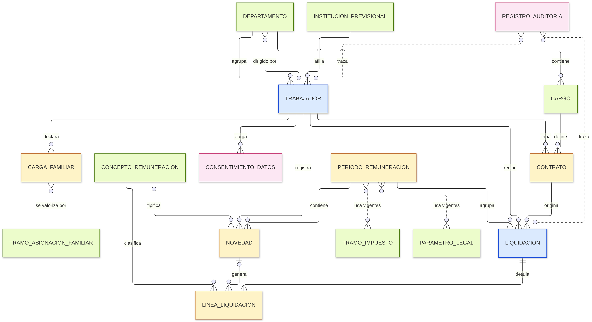
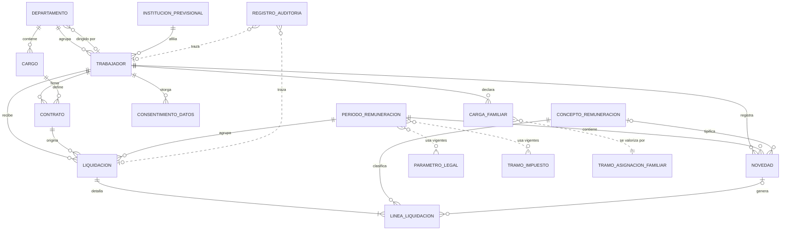

# Modelo de Datos: Módulo de Recursos Humanos y Planilla

## Modelo del módulo RR.HH. y Planilla

El módulo de Recursos Humanos y Planilla guarda los **Trabajadores** y las **Liquidaciones de Sueldo** en el almacenamiento común de la aplicación (`src/storage.js`, claves técnicas `erp_base_module:entities` y `erp_base_module:documents`). Las demás tablas del módulo se guardan en `localStorage` con el prefijo `erp_rrhh:*` y se vinculan mediante `entity_id` (trabajador) y `periodoId` (período). El detalle completo del MER y el diccionario de datos está en el [Apéndice A](#apéndice-a--mer-y-diccionario-de-datos-rrhh) de este mismo documento, con diagramas en [mer.png](mer.png), [mer.svg](mer.svg), [mer-resumen.png](mer-resumen.png) y fuente Mermaid en [mer.mmd](mer.mmd).

Trabajador, Contrato, Novedad y Período de Remuneración forman parte del modelo de este feature (001). Los Trabajadores se guardan en la clave `erp_base_module:entities`; las demás tablas del módulo usan `erp_rrhh:*`.

| Entidad de extensión | Clave sugerida | Campos principales | Relaciones |
|---|---|---|---|
| TRABAJADOR | `erp_base_module:entities` | `entity_id`, `taxId` (RUT), `fechaIngreso`, `fechaNacimiento`, `estadoLaboral`, `category` (departamento), `afp`, `sistemaSalud`, `banco`, `numeroCuenta`, `contactoEmergencia` | Tabla principal del módulo; es referenciado por contratos, novedades y liquidaciones |
| CONTRATO | `erp_rrhh:contratos` | `id`, `entity_id`, `sueldoBase`, `jornadaSemanal`, `tipoContrato`, `fechaInicio`, `fechaTermino`, `vigenciaDesde`, `vigenciaHasta` | Pertenece a un Trabajador; origina liquidaciones |
| PERIODO_REMUNERACION | `erp_rrhh:periodos` | `id`, `anio`, `mes`, `estado` (Abierto/Calculado/Cerrado), `cerradoPor`, `fechaCierre`, `uf`, `utm`, `imm` | Agrupa novedades y liquidaciones; congela parámetros al cerrar |
| NOVEDAD | `erp_rrhh:novedades` | `id`, `trabajadorEntityId`, `periodoId`, `tipo`, `cantidad`, `unidad`, `fechaInicio`, `fechaFin`, `estado`, `registradoPor`, `aprobadoPor`, `fechaAprobacion`, `motivoRechazo` | Pertenece a un Trabajador y a un Período; solo las aprobadas alimentan el cálculo |
| CONCEPTO_REMUNERACION | `erp_rrhh:conceptos` | `id`, `codigo`, `nombre`, `tipo`, `imponible`, `cuentaContable`, `esSensible` | Clasifica líneas de liquidación y novedades |
| CONJUNTO_PARAMETROS_LEGALES | `erp_rrhh:parametros-mes` | `id`, `anio`, `mes`, `valores`, `fuente`, `cargadoPor`, `bloqueado` | Conjunto completo usado por un Período; se bloquea desde el primer uso |
| PARAMETRO_LEGAL | `erp_rrhh:parametros` | `id`, `conjuntoId`, `codigo`, `descripcion`, `valor`, `unidad`, `fuente` | Pertenece a un conjunto por mes/año y se congela en la liquidación |
| TRAMO_IMPUESTO | `erp_rrhh:tramos-impuesto` | `id`, `conjuntoId`, `desdeUtm`, `hastaUtm`, `factor`, `rebaja`, `vigenciaDesde` | Sustenta el impuesto único dentro del conjunto |
| SOLICITUD_VACACION | `erp_rrhh:solicitudes-vacacion` | `id`, `entity_id`, `fechaInicio`, `fechaFin`, `diasHabiles`, `saldoDescontado`, `estado`, `auditadoPor` | US7; se recalcula si se agrega un feriado en el rango |
| FERIADO | `erp_rrhh:feriados` | `id`, `fecha`, `nombre`, `origen`, `anio` | US7; excluye días hábiles de solicitudes y períodos |
| CARGA_FAMILIAR | `erp_rrhh:cargas-familiares` | `id`, `entity_id`, `rut`, `nombre`, `parentesco`, `fechaNacimiento`, `vigenteDesde`, `vigenteHasta` | US8; RUT vigente único por Trabajador |
| LINEA_LIQUIDACION | `erp_rrhh:lineas-liquidacion` | `id`, `liquidacionId`, `conceptoId`, `tipo`, `monto`, `base`, `tasaFactor`, `formula`, `parametroSnapshot`, `motivoManual` | Pertenece a una Liquidación; conserva el snapshot del cálculo |
| REGISTRO_AUDITORIA | `erp_rrhh:auditoria` | `id`, `entidad`, `entidadId`, `accion`, `campos` (lista de `{ campo, valorAnterior, valorNuevo }`, con `[REDACTADO]` en datos sensibles), `usuario`, `rol`, `fecha`, `motivo` | Traza cálculo, aprobación, pago, anulación y consultas sensibles |

### Reglas de la extensión RR.HH.

- Un trabajador se identifica por su `entity_id`; sus contratos, novedades y liquidaciones referencian ese mismo `entity_id`.
- Un período agrupa una liquidación por trabajador; no se permiten duplicados para el mismo `entity_id` y `periodoId`.
- Solo las novedades en estado Aprobada son elegibles para el cálculo; las Pendientes o Rechazadas se excluyen y se informan.
- Al cerrar un período se congelan UF, UTM, IMM y los parámetros usados; las liquidaciones y novedades quedan de solo lectura.
- Cada línea conserva `base`, `tasaFactor`, `formula` y `parametroSnapshot` (código, valor aplicado, vigencia, fuente) para que la explicación no dependa de parámetros posteriores.
- Los cambios de sueldo se registran como un nuevo contrato o anexo con su vigencia, sin sobrescribir el contrato anterior.
- Los trabajadores con liquidaciones aprobadas o pagadas no se eliminan físicamente; se aplica baja lógica (`estadoLaboral = "Desvinculado"`). La eliminación en cascada solo aplica a fichas sin liquidaciones cerradas.
- Los datos de salud se limitan a tipo y días; se prohíbe almacenar diagnósticos, códigos CIE o texto clínico.
- Los roles Analista y Jefatura se validan en la capa de servicio y en la interfaz; la auditoría es de solo inserción.
- La sesión es simulada: el rol activo se mantiene en memoria y la auditoría registra ese rol, no una identidad verificada; no se almacenan credenciales.
- La bitácora de auditoría se conserva durante la relación laboral y 6 años después del término; no se elimina desde la interfaz. Registra consultas/cambios de datos sensibles, cambios de rol, accesos denegados y operaciones de exportación/importación de respaldo.
- El respaldo exporta las claves del espacio de trabajo en un único JSON versionado; la restauración valida el esquema y reemplaza los datos operativos solo tras confirmación explícita, sin sobrescribir ni eliminar los registros previos de auditoría (solo inserción).
- Un conjunto de parámetros legales se carga completo para un mes/año y se bloquea desde que un Período lo usa por primera vez; las correcciones se registran como otro conjunto para un mes distinto (US12).
- Una solicitud de vacaciones recalcula días hábiles y saldo descontado cuando se agrega un feriado en su rango, y deja constancia en auditoría (US7).
- Las exportaciones CSV se generan solo desde períodos cerrados; no crean ni modifican registros y su formato se define en `contracts/entity-storage.md` (US11).

---

## Apéndice A — MER y diccionario de datos RR.HH.

Contenido incorporado desde `specs/000-rrhh-planilla/data-model.md` al unificar la documentación del módulo en esta carpeta; los diagramas MER se movieron a esta misma carpeta. Es detalle de referencia del diseño RR.HH.: ante cualquier discrepancia con el cuerpo principal o con `spec.md`, prevalecen estos últimos.

### 1. Diagrama Entidad-Relación

- Imagen completa (con atributos): [`mer.png`](mer.png) · [`mer.svg`](mer.svg)
- Vista resumida (solo entidades y relaciones): [`mer-resumen.png`](mer-resumen.png)
- Fuente editable (Mermaid): [`mer.mmd`](mer.mmd)

Código de colores de la imagen:

| Color | Grupo | Tablas |
|---|---|---|
| Azul | **Tablas principales** (almacenamiento común de la aplicación) | TRABAJADOR, LIQUIDACION |
| Amarillo | Núcleo transaccional del módulo | CONTRATO, PERIODO_REMUNERACION, NOVEDAD, LINEA_LIQUIDACION, CARGA_FAMILIAR |
| Verde | Catálogos y parámetros | DEPARTAMENTO, CARGO, INSTITUCION_PREVISIONAL, CONCEPTO_REMUNERACION, PARAMETRO_LEGAL, TRAMO_IMPUESTO, TRAMO_ASIGNACION_FAMILIAR |
| Rosado | Gobierno de datos (riesgos y sesgos) | CONSENTIMIENTO_DATOS, REGISTRO_AUDITORIA |

Diagrama Mermaid (GitHub lo dibuja directamente)

Las líneas punteadas son relaciones lógicas (se resuelven por fecha de vigencia o por referencia polimórfica), no llaves foráneas almacenadas.

### 2. Diccionario de datos

Convención: los campos comunes del almacenamiento (`id`, `entity_id`, `name`, `code`, `taxId`, etc.) conservan su nombre técnico en inglés (columna Origen = común); los campos propios de RR.HH. usan `camelCase` en español (Origen = RR.HH.). Las llaves foráneas al Trabajador se llaman `entity_id` y a la Liquidación `document_id`.

Clasificación de cada dato (se usa para permisos, sección 4):
**I** = uso interno · **C** = confidencial (solo RR.HH. / el propio trabajador) · **S** = sensible según la Ley 21.719 (acceso restringido y registrado en auditoría).

#### 2.1 TRABAJADOR — clave `erp_base_module:entities`

| Campo | Origen | Tipo | Significado en RR.HH. | Restricciones | Clas. |
|---|---|---|---|---|---|
| id | común | string | Identificador interno | Autogenerado | I |
| entity_id | común | string | Identificador público del trabajador (une todas las tablas) | Autogenerado, único | I |
| name | común | string | Nombre legal completo | Obligatorio | I |
| code | común | string | N° de ficha (p. ej., `TRB-0001`) | Obligatorio, único | I |
| taxId | común | string | RUT con dígito verificador | Obligatorio en el módulo; formato `12345678-9`; DV válido (módulo 11); único | C |
| email | común | string | Correo de contacto | Formato válido | I |
| phone | común | string | Teléfono | Opcional | C |
| address | común | string | Domicilio | Opcional | C |
| category | común | string | Código del departamento (FK lógica a `DEPARTAMENTO.codigo`) | Debe existir en DEPARTAMENTO | I |
| description | común | string | Observaciones generales (sin datos de salud) | Opcional | C |
| targetDate | común | date | Fecha de término del contrato vigente (alerta de vencimiento de plazo fijo) | Se sincroniza con `CONTRATO.fechaTermino` | I |
| creditLimit | común | number | Tope mensual de anticipo de sueldo | ≥ 0 | C |
| paymentTerms | común | string | Forma de pago (Transferencia, Cheque, Efectivo) | Opcional | I |
| createdAt / updatedAt | común | string | Marcas de tiempo | Automáticas | I |
| fechaNacimiento | RR.HH. | date | Para validar edad legal (≥ 18 o autorización) | Obligatorio | C |
| fechaIngreso | RR.HH. | date | Antigüedad: vacaciones progresivas, indemnización | Obligatorio | I |
| genero | RR.HH. | select | Solo para reportes agregados de equidad salarial | Opcional, incluye "Prefiere no informar" | **S** |
| nombreSocial | RR.HH. | text | Referencia histórica (Ley 21.120) fuera de alcance en esta versión; no se captura ni se muestra en pantalla | No aplica | — |
| nacionalidad | RR.HH. | text | Control del art. 19 del Código del Trabajo (proporción de trabajadores chilenos) | Opcional | C |
| afp | RR.HH. | select | AFP de afiliación (FK lógica a INSTITUCION_PREVISIONAL tipo AFP) | Obligatorio | C |
| sistemaSalud | RR.HH. | select | FONASA o Isapre | Obligatorio | C |
| planIsapreUF | RR.HH. | number | Valor del plan pactado en UF (si es Isapre) | Obligatorio si `sistemaSalud = Isapre`; > 0 | C |
| banco / numeroCuenta | RR.HH. | text | Datos para el depósito del sueldo | Opcional | C |
| contactoEmergencia | RR.HH. | text | Nombre y teléfono | Opcional | C |
| estadoLaboral | RR.HH. | select | Activo / Con licencia / Desvinculado | Obligatorio | I |

#### 2.2 LIQUIDACION — clave `erp_base_module:documents`

| Campo | Origen | Tipo | Significado en Planilla | Restricciones |
|---|---|---|---|---|
| id | común | string | Identificador de la liquidación | Autogenerado |
| entity_id | común | string | Trabajador liquidado | Debe existir (integridad referencial) |
| series | común | string | Serie fija `LIQ` | — |
| folio | común | number | Correlativo de liquidaciones | Entero positivo; **único por serie** (extensión) |
| startDate | común | date | Primer día del período | = día 1 del mes del período |
| endDate | común | date | Último día del período | ≥ startDate |
| quantity | común | number | Días trabajados en el mes (base 30) | Entero 1–30; vacío si el mes completo es licencia |
| subtotal | común | number | **Total haberes** | ≥ 0 |
| discount | común | number | **Total descuentos** legales y voluntarios (sin impuesto) | ≥ 0 y ≤ subtotal |
| taxAmount | común | number | **Impuesto único de segunda categoría** | ≥ 0 |
| totalAmount | común | number | **Líquido a pagar** = subtotal − discount − taxAmount | ≥ 0 |
| currency | común | string | `CLP` | Fijo |
| paymentTerms | común | string | Forma de pago heredada del trabajador | — |
| notes | común | string | Observaciones | Sin datos de salud |
| status | común | string | Estado de la liquidación | Borrador o cerrada, según el estado del período |
| periodoId | RR.HH. | text | FK a PERIODO_REMUNERACION | Obligatorio; **una liquidación no anulada por trabajador y período** |
| contratoId | RR.HH. | text | FK a CONTRATO vigente en el período | Obligatorio |
| totalImponible | RR.HH. | number | Base para cotizaciones (antes de topes) | ≥ 0 |
| totalTributable | RR.HH. | number | Base del impuesto único | ≥ 0 |
| costoEmpleador | RR.HH. | number | Haberes + aportes patronales (no se descuenta al trabajador) | ≥ subtotal |

#### 2.3 CONTRATO — `erp_rrhh:contratos`

| Campo | Tipo | Descripción | Restricciones |
|---|---|---|---|
| id | string | PK | Autogenerado |
| entity_id | string | FK → TRABAJADOR | Obligatorio |
| cargo_id | string | FK → CARGO | Obligatorio |
| tipoContrato | string | `indefinido`, `plazo_fijo`, `obra_faena` | Obligatorio |
| fechaInicio | date | Inicio de la relación laboral o del anexo | Obligatorio |
| fechaTermino | date | Término pactado | Obligatorio si es `plazo_fijo`; ≥ fechaInicio |
| jornadaHorasSemanales | number | Jornada pactada | > 0 y ≤ máximo legal vigente (`PARAMETRO_LEGAL.JORNADA_MAX`, 42 h desde abril 2026) |
| sueldoBase | number | Sueldo base mensual | ≥ ingreso mínimo proporcional a la jornada |
| modalidadGratificacion | string | `art50` (25 % con tope), `art47` (30 % de utilidades), `sin` | Obligatorio |
| asignacionColacion | number | Haber no imponible fijo | ≥ 0 |
| asignacionMovilizacion | number | Haber no imponible fijo | ≥ 0 |
| estado | string | `vigente`, `terminado` | **Máximo un contrato vigente por trabajador** |
| causalTermino | string | Artículo del Código del Trabajo (159, 160, 161) | Obligatorio si `estado = terminado` |

#### 2.4 CARGO — `erp_rrhh:cargos`

| Campo | Tipo | Descripción | Restricciones |
|---|---|---|---|
| id | string | PK | — |
| codigo | string | Código del cargo | Único |
| nombre | string | Nombre del cargo | Obligatorio |
| departamento_id | string | FK → DEPARTAMENTO | Obligatorio |
| bandaSalarialMin / bandaSalarialMax | number | Referencia histórica fuera de alcance; no se captura ni valida en esta versión | No aplica |

#### 2.5 DEPARTAMENTO — `erp_rrhh:departamentos`

| Campo | Tipo | Descripción | Restricciones |
|---|---|---|---|
| id | string | PK | — |
| codigo | string | Código corto (`ADM`, `OPE`, `VTA`), se guarda en `Trabajador.category` | Único |
| nombre | string | Nombre del área | Obligatorio |
| centroCosto | string | Código de centro de costo **compartido con el módulo de Contabilidad** | Obligatorio |
| jefatura_entity_id | string | FK → TRABAJADOR que dirige el área | Opcional |

#### 2.6 INSTITUCION_PREVISIONAL — `erp_rrhh:instituciones`

| Campo | Tipo | Descripción | Restricciones |
|---|---|---|---|
| id | string | PK | — |
| codigo | string | `HABITAT`, `FONASA`, `ACHS`, … | Único |
| nombre | string | Nombre de la institución | — |
| tipo | string | `AFP`, `SALUD`, `MUTUAL`, `CCAF` | — |
| tasa | number | % de cotización (AFP: 10 % + comisión de la administradora; FONASA: 7 %; Mutual: tasa básica + adicional) | ≥ 0 |
| vigenciaDesde | date | Desde cuándo rige la tasa | — |

#### 2.7 PERIODO_REMUNERACION — `erp_rrhh:periodos`

| Campo | Tipo | Descripción | Restricciones |
|---|---|---|---|
| id | string | PK | — |
| anio / mes | number | Período (p. ej., 2026 / 10) | Par único |
| estado | string | `abierto` → `calculado` → `cerrado` | Cerrado = no se editan sus liquidaciones ni novedades |
| fechaPago | date | Fecha de pago de los sueldos | — |
| valorUF / valorUTM | number | Valores congelados al cierre (UF del último día del mes; UTM del mes) | > 0 |
| ingresoMinimo | number | Ingreso mínimo mensual vigente en el período | > 0 |

#### 2.8 CONCEPTO_REMUNERACION — `erp_rrhh:conceptos`

Catálogo de haberes y descuentos. Ejemplos precargados: `SUELDO_BASE`, `HORAS_EXTRA`, `GRATIFICACION`, `BONO`, `COLACION`, `MOVILIZACION`, `ASIG_FAMILIAR`, `COT_AFP`, `COT_SALUD`, `SEG_CESANTIA`, `IMPUESTO_UNICO`, `ANTICIPO`, `CUOTA_SINDICAL`, `APORTE_EMP_AFC`, `APORTE_EMP_PREVISIONAL`, `APORTE_EMP_MUTUAL`.

| Campo | Tipo | Descripción | Restricciones |
|---|---|---|---|
| id | string | PK | — |
| codigo | string | Código del concepto | Único |
| nombre | string | Nombre visible en la liquidación | — |
| tipo | string | `haber_imponible`, `haber_no_imponible`, `descuento_legal`, `descuento_voluntario`, `aporte_empleador` | — |
| imponible / tributable | bool | Si suma a la base de cotizaciones / de impuesto | — |
| metodoCalculo | string | `fijo`, `porcentaje`, `formula`, `novedad` | — |
| valorDefecto | number | Monto o porcentaje por defecto | ≥ 0 |
| esSensible | bool | El concepto revela un dato sensible (p. ej., `CUOTA_SINDICAL` revela afiliación sindical) | Si es `true`, solo RR.HH. lo ve y su consulta queda auditada |
| cuentaContable | string | Cuenta para el asiento de remuneraciones (**integración con Contabilidad**) | Obligatorio |

#### 2.9 LINEA_LIQUIDACION — `erp_rrhh:lineas`

Detalle de la liquidación: una línea por concepto.

| Campo | Tipo | Descripción | Restricciones |
|---|---|---|---|
| id | string | PK | — |
| document_id | string | FK → LIQUIDACION | Obligatorio; se elimina en cascada con la liquidación |
| concepto_id | string | FK → CONCEPTO_REMUNERACION | Obligatorio |
| novedad_id | string | FK → NOVEDAD que originó la línea | Opcional |
| cantidad | number | Horas, días o unidades | ≥ 0 |
| valorUnitario | number | Valor por unidad (p. ej., valor hora extra) | ≥ 0 |
| baseCalculo | number | Base sobre la que se aplicó el % (si aplica) | ≥ 0 |
| monto | number | Resultado de la línea en CLP | ≥ 0 (el signo lo da el `tipo` del concepto) |
| origen | string | `automatico`, `manual`, `novedad` | Las líneas manuales exigen motivo en auditoría |

Reglas de consistencia: `LIQUIDACION.subtotal = Σ montos de haberes`; `discount = Σ descuentos legales y voluntarios (sin IMPUESTO_UNICO)`; `taxAmount = monto de IMPUESTO_UNICO`; `costoEmpleador = subtotal + Σ aportes del empleador`.

#### 2.10 NOVEDAD — `erp_rrhh:novedades`

Movimientos del mes que alteran la liquidación.

| Campo | Tipo | Descripción | Restricciones |
|---|---|---|---|
| id | string | PK | — |
| entity_id | string | FK → TRABAJADOR | Obligatorio |
| periodo_id | string | FK → PERIODO_REMUNERACION | El período debe estar `abierto` |
| concepto_id | string | FK → CONCEPTO (para bonos y anticipos) | Opcional |
| tipo | string | `horas_extra`, `licencia_medica`, `vacaciones`, `permiso_con_goce`, `permiso_sin_goce`, `ausencia_injustificada`, `bono`, `anticipo` | — |
| fechaInicio / fechaFin | date | Rango afectado | fechaFin ≥ fechaInicio; dentro del período |
| cantidad | number | Horas, días o pesos | > 0; horas extra ≤ 2 por día (art. 31 CT) |
| unidad | string | `horas`, `dias`, `pesos` | Coherente con el tipo |
| estado | string | `registrada` → `aprobada` / `rechazada` → `aplicada` | Solo las aprobadas entran al cálculo |
| observacion | string | Comentario breve | **Prohibido registrar diagnósticos médicos** |

#### 2.11 CARGA_FAMILIAR — `erp_rrhh:cargas`

| Campo | Tipo | Descripción | Restricciones |
|---|---|---|---|
| id | string | PK | — |
| entity_id | string | FK → TRABAJADOR | Obligatorio |
| nombre / rut | string | Identificación de la carga (dato de un tercero: C) | RUT válido |
| parentesco | string | Hijo/a, cónyuge, madre/padre, otro | — |
| fechaNacimiento | date | Para verificar requisitos de edad | — |
| vigenteDesde / vigenteHasta | date | Vigencia del reconocimiento | — |

#### 2.12 Tablas de parámetros legales (conjuntos completos por mes/año)

Los valores legales **no se escriben en el código**: se guardan en conjuntos completos por mes y año. El motor de cálculo toma íntegramente el conjunto del período. Así un cambio de ley (como la reforma de pensiones) se resuelve cargando otro conjunto, no programando.

**CONJUNTO_PARAMETROS_LEGALES** — `erp_rrhh:parametros-mes`: `id`, `anio`, `mes`, `valores` (objeto con todos los códigos obligatorios), `fuente`, `cargadoPor`, `bloqueado`, `creadoAt`. Un conjunto se bloquea desde que un Período lo usa por primera vez; no se edita y las correcciones se cargan como otro conjunto para un mes distinto (FR-105, US12).

**PARAMETRO_LEGAL** — `erp_rrhh:parametros`: `id`, `conjuntoId`, `codigo`, `descripcion`, `valor`, `unidad` (`pct`, `UF`, `UTM`, `CLP`, `horas`), `fuente`. Cada fila pertenece a un conjunto completo por mes/año, hereda el mes/año del conjunto y se congela en la liquidación.

Valores de referencia para la carga inicial (deben verificarse en Previred / SII / Superintendencia de Pensiones antes de la demo):

| codigo | valor | unidad | vigencia desde | fuente |
|---|---|---|---|---|
| IMM | 553.553 | CLP | 2026-05-01 | Ley 21.830 |
| TOPE_IMPONIBLE_AFP_SALUD | 90 | UF | 2026-02-01 | Res. Ex. N° 237, Superintendencia de Pensiones |
| TOPE_IMPONIBLE_AFC | 135,2 | UF | 2026 | Indicadores previsionales |
| TASA_AFP_TRABAJADOR | 10 | pct | — | DL 3.500 (+ comisión según AFP) |
| TASA_SALUD_LEGAL | 7 | pct | — | Ley 18.469 / 18.933 |
| TASA_AFC_TRAB_INDEF | 0,6 | pct | — | Ley 19.728 |
| TASA_AFC_EMP_INDEF | 2,4 | pct | — | Ley 19.728 |
| TASA_AFC_EMP_PLAZO | 3,0 | pct | — | Ley 19.728 |
| APORTE_EMP_PREVISIONAL | 3,5 | pct | 2026-08-01 | Ley 21.735 (reforma de pensiones; sube gradualmente hasta 8,5 %) |
| JORNADA_MAX | 42 | horas | 2026-04-26 | Ley 21.561 (40 h desde 2028) |
| RECARGO_HORA_EXTRA | 50 | pct | — | Art. 32 CT |
| TOPE_GRATIF_ANUAL_IMM | 4,75 | IMM | — | Art. 50 CT |
| TOPE_DESC_VOLUNTARIOS | 15 | pct | — | Art. 58 CT |

**TRAMO_IMPUESTO** — `erp_rrhh:tramos_impuesto`: `id`, `desdeUTM`, `hastaUTM`, `factor`, `rebajaUTM`, `vigenciaDesde`. Impuesto = base tributable × factor − rebaja (convertida a pesos con la UTM del período). Tramos de referencia (SII): exento hasta 13,5 UTM; 4 % hasta 30; 8 % hasta 50; 13,5 % hasta 70; 23 % hasta 90; 30,4 % hasta 120; 35 % hasta 310; 40 % sobre 310.

**TRAMO_ASIGNACION_FAMILIAR** — `erp_rrhh:tramos_asignacion`: `id`, `tramo`, `ingresoDesde`, `ingresoHasta`, `montoPorCarga`, `vigenciaDesde`. Referencia vigente: tramo A hasta $649.039 → $22.601 por carga; B hasta $947.990 → $13.870; C hasta $1.478.539 → $4.382; D sobre eso → $0.

#### 2.13 Vacaciones y feriados (US7)

**SOLICITUD_VACACION** — `erp_rrhh:solicitudes-vacacion`: `id`, `entity_id`, `fechaInicio`, `fechaFin`, `diasHabiles`, `saldoDescontado`, `estado`, `registradoPor`, `auditadoPor`. Los días hábiles excluyen sábados, domingos y feriados; al agregar un feriado dentro del rango se recalculan días y saldo, y se escribe en auditoría (FR-088–FR-091, SC-024).

**FERIADO** — `erp_rrhh:feriados`: `id`, `fecha`, `nombre`, `origen`, `anio`. Los feriados se cargan manualmente y afectan solicitudes de vacaciones y conteo de días hábiles de ausentismo.

#### 2.14 Cargas familiares y asignación familiar (US8)

**CARGA_FAMILIAR** — `erp_rrhh:cargas-familiares`: `id`, `entity_id`, `rut`, `nombre`, `parentesco`, `fechaNacimiento`, `vigenteDesde`, `vigenteHasta`. El RUT debe ser válido y único entre cargas vigentes; al alcanzar la edad límite se genera aviso con 30 días de anticipación. El monto se calcula con `TRAMO_ASIGNACION_FAMILIAR` vigente (FR-092–FR-094, SC-025).

#### 2.15 Simulador, reportes y exportaciones (US9–US11)

El simulador y los reportes no requieren tablas nuevas: el primero ejecuta el motor de cálculo en modo referencial sin persistir, y los segundos se derivan de períodos cerrados, liquidaciones, novedades y conceptos. Las exportaciones CSV tampoco crean registros; solo consultan períodos cerrados y registran la acción en `erp_rrhh:auditoria`. La forma de los archivos se define en `contracts/entity-storage.md`.

#### 2.16 Gobierno de datos

**CONSENTIMIENTO_DATOS** — `erp_rrhh:consentimientos`

| Campo | Tipo | Descripción | Restricciones |
|---|---|---|---|
| id | string | PK | — |
| entity_id | string | FK → TRABAJADOR | Obligatorio |
| finalidad | string | Para qué se usa el dato (p. ej., `reporte_equidad_genero`, `contacto_emergencia`) | Un registro por finalidad (consentimiento específico) |
| version | string | Versión del texto informado al trabajador | — |
| otorgadoAt / revocadoAt | date | Fechas de otorgamiento y revocación | Si está revocado, el dato deja de usarse para esa finalidad |
| evidencia | string | Referencia al anexo firmado | Obligatorio |

**REGISTRO_AUDITORIA** — `erp_rrhh:auditoria`

| Campo | Tipo | Descripción | Restricciones |
|---|---|---|---|
| id | string | PK | — |
| fecha | string | Marca de tiempo ISO | Automática |
| rolActor | string | Rol simulado que ejecutó la acción | — |
| accion | string | `crear`, `editar`, `eliminar`, `ver_sensible`, `exportar`, `cambio_estado` | — |
| tabla / registroId | string | Referencia polimórfica al registro afectado | — |
| camposModificados | array | Campos modificados como `{ campo, valorAnterior, valorNuevo }`; los valores de datos sensibles se registran como `[REDACTADO]` | — |
| motivo | string | Justificación (obligatoria en líneas manuales y anulaciones) | — |

Registro de solo inserción: la interfaz no permite editarlo ni borrarlo.

### 3. Relaciones y cardinalidades

| Relación | Cardinalidad | Llave | Regla de integridad |
|---|---|---|---|
| Trabajador → Liquidación | 1 : N | `entity_id` | 1 liquidación no anulada por trabajador y período |
| Trabajador → Contrato | 1 : N | `entity_id` | Máximo 1 contrato `vigente` a la vez; anexos y recontrataciones quedan en historial |
| Trabajador → Novedad | 1 : N | `entity_id` | Solo en períodos abiertos |
| Trabajador → Carga familiar | 1 : N | `entity_id` | — |
| Trabajador → Consentimiento | 1 : N | `entity_id` | Uno por finalidad |
| Departamento → Trabajador | 1 : N | `category` = `codigo` | No se puede eliminar un departamento con trabajadores activos |
| Departamento → Trabajador (jefatura) | N : 0..1 | `jefatura_entity_id` | La jefatura debe estar activa |
| Institución previsional → Trabajador | 1 : N | `afp` / `sistemaSalud` = `codigo` | La institución debe existir y estar vigente |
| Departamento → Cargo | 1 : N | `departamento_id` | — |
| Cargo → Contrato | 1 : N | `cargo_id` | Sin validación de banda salarial en esta versión (referencia histórica fuera de alcance) |
| Contrato → Liquidación | 1 : N | `contratoId` | El contrato debe estar vigente en el período |
| Período → Liquidación | 1 : N | `periodoId` | Período cerrado = liquidaciones de solo lectura |
| Período → Novedad | 1 : N | `periodo_id` | — |
| Liquidación → Línea | 1 : 1..N | `document_id` | Cascada al eliminar una liquidación en borrador |
| Concepto → Línea | 1 : N | `concepto_id` | Un concepto usado no se elimina, se desactiva |
| Concepto → Novedad | 0..1 : N | `concepto_id` | — |
| Novedad → Línea | 0..1 : N | `novedad_id` | Al aplicar la novedad, su estado pasa a `aplicada` |
| Período → Conjunto de parámetros | N : 1 | `conjuntoId` | El conjunto del mes/año; bloqueado desde el primer uso |
| Conjunto → Parámetro legal / Tramo impuesto | 1 : N | `conjuntoId` | Todos los valores obligatorios deben estar presentes |
| Trabajador → Solicitud de vacaciones | 1 : N | `entity_id` | Recálculo al agregar feriados en el rango |
| Feriado ⇢ Solicitud de vacaciones | lógica | `fecha` dentro de `fechaInicio`/`fechaFin` | Ajusta días hábiles y saldo |
| Trabajador → Carga familiar | 1 : N | `entity_id` | RUT vigente único |
| Carga familiar ⇢ Tramo asignación | lógica | por ingreso y fecha | — |
| Auditoría ⇢ cualquier tabla | lógica | `tabla` + `registroId` | Solo inserción |

### 4. Clasificación de datos y acceso por rol

El MVP es solo frontend, así que el control de acceso es **simulado** (selector de rol en la barra superior). Sirve para mostrar el diseño que tendría la versión con servidor.

| Rol | Datos I | Datos C | Datos S | Puede aprobar |
|---|---|---|---|---|
| Administrador/a RR.HH. | Ver y editar | Ver y editar | Ver (queda auditado) | Período y liquidaciones |
| Analista de remuneraciones | Ver y editar | Ver y editar (excepto banco) | No (ve solo agregados) | Calcular liquidaciones |
| Jefatura de área | Su equipo | No ve sueldos | No | Novedades de su equipo |
| Trabajador | Su ficha | Sus liquidaciones | Sus propios datos | — |

Gerencia / Finanzas y Contador/a externo son actores externos sin sesión: consumen reportes y CSV desde períodos cerrados y aprueban el cierre fuera del módulo, por lo que no figuran en el selector de roles del MVP.

### 5. Datos para análisis y reportes

Variables derivadas que el módulo calcula a partir del MER (base del "método de análisis" del MVP):

| Indicador | Fórmula (tablas) | Uso |
|---|---|---|
| Costo total de planilla por período y centro de costo | Σ `costoEmpleador` agrupado por `DEPARTAMENTO.centroCosto` | Gerencia y módulo de Contabilidad |
| Dotación activa, altas y bajas | TRABAJADOR.estadoLaboral, CONTRATO.fechaInicio / fechaTermino | Panel principal |
| Contratos a plazo fijo por vencer (30 días) | `targetDate` − hoy ≤ 30 | Alertas |
| Horas extra por área | Σ NOVEDAD.cantidad (`horas_extra`) | Control de jornada |
| Posición en banda salarial | Referencia histórica fuera de alcance; no se calcula en esta versión | — |
| **Brecha salarial de género por cargo** | Mediana del sueldo base por género dentro de cada CARGO | Detección de sesgos. Solo se muestra si cada grupo tiene ≥ 5 personas (si no, se oculta para no identificar a nadie) |
| Ausentismo | Días de `ausencia_injustificada` / días hábiles | **Excluye licencias médicas y permisos legales**, para no castigar maternidad ni enfermedad |
