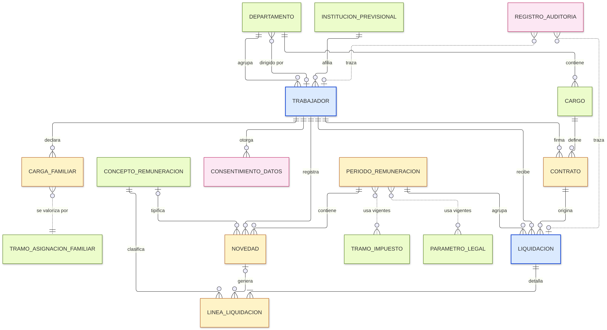
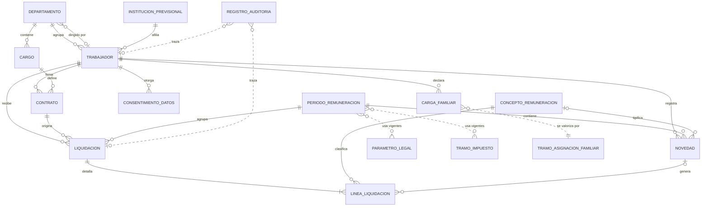

# Modelo de Datos: Módulo de Recursos Humanos y Planilla (Remuneraciones)

**Rama**: `002-rrhh-planilla` | **Fecha**: 2026-10-20 | **Plan**: [plan.md](plan.md)
**Estructura base**: [`specs/001-erp-base-module/data-model.md`](../001-erp-base-module/data-model.md)

Este documento describe el Modelo Entidad-Relación (MER) del módulo **Recursos Humanos y Planilla** y cómo se monta sobre la estructura base del ERP (Entity + Document + ModuleConfig) **sin modificar el código central**.

---

## 1. Diagrama Entidad-Relación

- Imagen completa (con atributos): [`mer.png`](mer.png) · [`mer.svg`](mer.svg)
- Vista resumida (solo entidades y relaciones): [`mer-resumen.png`](mer-resumen.png)
- Fuente editable (Mermaid): [`mer.mmd`](mer.mmd)

Código de colores de la imagen:

| Color | Grupo | Tablas |
|---|---|---|
| Azul | **Heredadas de la base** (Entity / Document renombradas) | TRABAJADOR, LIQUIDACION |
| Amarillo | Núcleo transaccional del módulo | CONTRATO, PERIODO_REMUNERACION, NOVEDAD, LINEA_LIQUIDACION, CARGA_FAMILIAR |
| Verde | Catálogos y parámetros | DEPARTAMENTO, CARGO, INSTITUCION_PREVISIONAL, CONCEPTO_REMUNERACION, PARAMETRO_LEGAL, TRAMO_IMPUESTO, TRAMO_ASIGNACION_FAMILIAR |
| Rosado | Gobierno de datos (riesgos y sesgos) | CONSENTIMIENTO_DATOS, REGISTRO_AUDITORIA |



<details>
<summary>Diagrama Mermaid (GitHub lo dibuja directamente)</summary>



Las líneas punteadas son relaciones lógicas (se resuelven por fecha de vigencia o por referencia polimórfica), no llaves foráneas almacenadas.

</details>

---

## 2. Compatibilidad con la estructura base

La base ofrece dos tipos de registro (Entity y Document) unidos por `entity_id`, campos personalizados (`customFields`), un ciclo de vida de estados (`statusLifecycle`) y persistencia en `localStorage`. El módulo usa esas piezas así:

| Pieza de la base | Uso en RR.HH. y Planilla |
|---|---|
| **Entity** | **Trabajador** (ficha del personal). Se conservan todos los campos base con su nombre y semántica. |
| **Document** | **Liquidación de Sueldo** (un documento por trabajador y período). |
| `entity_id` | Llave que une al trabajador con sus liquidaciones **y** con todas las tablas de extensión (CONTRATO, NOVEDAD, CARGA_FAMILIAR, CONSENTIMIENTO_DATOS). |
| `customFields` | Datos laborales/previsionales del trabajador y totales adicionales de la liquidación (sección 3). |
| `statusLifecycle` | Flujo de aprobación de la liquidación: `borrador → calculada → aprobada → pagada`, con `anulada` como salida. |
| `labels` | `Trabajador / Trabajadores`, `Liquidación de Sueldo / Liquidaciones de Sueldo`. |
| `localStorage` | Las tablas base siguen en `erp_base_module:entities` y `erp_base_module:documents`. Las tablas de extensión usan claves propias `erp_rrhh:<tabla>` (p. ej., `erp_rrhh:contratos`), con el mismo patrón de id autogenerado y marcas `createdAt`/`updatedAt`. |
| Puntos de extensión declarados por la base | Se usan los tres que la base deja abiertos: **partidas de documento** (LINEA_LIQUIDACION), **unicidad de folio por serie** y **cálculo automático de totales** (motor de cálculo de la planilla). |

### 2.1 Reglas de compatibilidad

1. **Ningún campo base se renombra ni cambia de tipo.** Cuando un campo base no aplica directamente, se le asigna un significado del dominio compatible con su tipo y validación (tabla 3.1 y 3.2).
2. **Las claves de campos personalizados no chocan** con la lista de campos base (`id`, `entity_id`, `name`, `code`, `taxId`, …). Por eso el RUT se guarda en `taxId` y no en un campo `rut` nuevo.
3. **Tipos admitidos**: los campos personalizados usan solo `text`, `number`, `date` o `select`, que son los que acepta la base.
4. **Eliminación en cascada (diferencia deliberada)**: la base borra los documentos de una entidad eliminada. En remuneraciones eso borraría información que la ley obliga a conservar (libro de remuneraciones). Por eso el módulo **no elimina trabajadores que tengan liquidaciones aprobadas o pagadas**: los marca como `estadoLaboral = "Desvinculado"` (baja lógica). La eliminación física solo queda permitida para fichas sin liquidaciones cerradas (p. ej., una ficha creada por error). La regla se aplica en la capa de interfaz del módulo, sin tocar el `storage.js` base.
5. **Fórmula de totales**: la base sugiere `total = subtotal − descuento + impuesto` solo como ejemplo y no la impone. En una liquidación el impuesto **se descuenta**, así que el módulo usa `totalAmount = subtotal − discount − taxAmount`. Cada importe sigue cumpliendo las validaciones base (no negativos y `discount ≤ subtotal`).
6. **Búsqueda**: como la búsqueda base recorre los campos de la Entity, se puede buscar trabajadores por nombre, RUT, código de ficha, correo, departamento y forma de pago sin desarrollo adicional.

### 2.2 Configuración propuesta (`src/module-config.js`)

> El borrador actual de la rama `feature-diseño-rrhh` (`export const config = { name: … entities: [...] }`) no sigue la forma `userConfig` que espera la base y además tiene un error de sintaxis (falta una coma después de `name`). Esta es la forma compatible:

```js
export const userConfig = {
  moduleName: "Recursos Humanos y Planilla",
  labels: {
    entity: "Trabajador", entities: "Trabajadores",
    document: "Liquidación de Sueldo", documents: "Liquidaciones de Sueldo",
  },
  customFields: [
    // --- Trabajador (Entity) ---
    { target: "entity", key: "fechaNacimiento", label: "Fecha de nacimiento", type: "date", required: true },
    { target: "entity", key: "fechaIngreso", label: "Fecha de ingreso", type: "date", required: true },
    { target: "entity", key: "genero", label: "Género", type: "select",
      options: ["Femenino", "Masculino", "No binario", "Prefiere no informar"] },
    { target: "entity", key: "nombreSocial", label: "Nombre social", type: "text" },
    { target: "entity", key: "nacionalidad", label: "Nacionalidad", type: "text" },
    { target: "entity", key: "afp", label: "AFP", type: "select", required: true,
      options: ["Capital", "Cuprum", "Habitat", "Modelo", "PlanVital", "Provida", "Uno"] },
    { target: "entity", key: "sistemaSalud", label: "Sistema de salud", type: "select", required: true,
      options: ["FONASA", "Isapre"] },
    { target: "entity", key: "planIsapreUF", label: "Plan Isapre (UF)", type: "number" },
    { target: "entity", key: "banco", label: "Banco", type: "text" },
    { target: "entity", key: "numeroCuenta", label: "N° de cuenta", type: "text" },
    { target: "entity", key: "contactoEmergencia", label: "Contacto de emergencia", type: "text" },
    { target: "entity", key: "estadoLaboral", label: "Estado laboral", type: "select", required: true,
      options: ["Activo", "Con licencia", "Desvinculado"] },
    // --- Liquidación (Document) ---
    { target: "document", key: "periodoId", label: "Período", type: "text", required: true },
    { target: "document", key: "contratoId", label: "Contrato", type: "text", required: true },
    { target: "document", key: "totalImponible", label: "Total imponible", type: "number" },
    { target: "document", key: "totalTributable", label: "Total tributable", type: "number" },
    { target: "document", key: "costoEmpleador", label: "Costo empleador", type: "number" },
  ],
  statusLifecycle: {
    statuses: ["borrador", "calculada", "aprobada", "pagada", "anulada"],
    transitions: {
      borrador: ["calculada", "anulada"],
      calculada: ["borrador", "aprobada", "anulada"],
      aprobada: ["pagada", "anulada"],
      pagada: [],
      anulada: [],
    },
  },
  theme: { accentColor: "#0f766e" },
};
```

---

## 3. Diccionario de datos

Convención: los campos heredados mantienen el nombre en inglés de la base; los campos nuevos del módulo usan `camelCase` en español. Las llaves foráneas hacia la base se llaman igual que en la base (`entity_id`) o `document_id` (id de la Liquidación).

Clasificación de cada dato (se usa para permisos, sección 5):
**I** = uso interno · **C** = confidencial (solo RR.HH. / el propio trabajador) · **S** = sensible según la Ley 21.719 (acceso restringido y registrado en auditoría).

### 3.1 TRABAJADOR (Entity base) — clave `erp_base_module:entities`

| Campo | Origen | Tipo | Significado en RR.HH. | Restricciones | Clas. |
|---|---|---|---|---|---|
| id | base | string | Identificador interno | Autogenerado | I |
| entity_id | base | string | Identificador público del trabajador (une todas las tablas) | Autogenerado, único | I |
| name | base | string | Nombre legal completo | Obligatorio | I |
| code | base | string | N° de ficha (p. ej., `TRB-0001`) | Obligatorio, único | I |
| taxId | base | string | RUT con dígito verificador | Obligatorio en el módulo; formato `12345678-9`; DV válido (módulo 11); único | C |
| email | base | string | Correo de contacto | Formato válido | I |
| phone | base | string | Teléfono | Opcional | C |
| address | base | string | Domicilio | Opcional | C |
| category | base | string | Código del departamento (FK lógica a `DEPARTAMENTO.codigo`) | Debe existir en DEPARTAMENTO | I |
| description | base | string | Observaciones generales (sin datos de salud) | Opcional | C |
| targetDate | base | date | Fecha de término del contrato vigente (alerta de vencimiento de plazo fijo) | Se sincroniza con `CONTRATO.fechaTermino` | I |
| creditLimit | base | number | Tope mensual de anticipo de sueldo | ≥ 0 | C |
| paymentTerms | base | string | Forma de pago (Transferencia, Cheque, Efectivo) | Opcional | I |
| createdAt / updatedAt | base | string | Marcas de tiempo | Automáticas | I |
| fechaNacimiento | custom | date | Para validar edad legal (≥ 18 o autorización) | Obligatorio | C |
| fechaIngreso | custom | date | Antigüedad: vacaciones progresivas, indemnización | Obligatorio | I |
| genero | custom | select | Solo para reportes agregados de equidad salarial | Opcional, incluye "Prefiere no informar" | **S** |
| nombreSocial | custom | text | Nombre con el que la persona se identifica (Ley 21.120); se muestra en pantalla si existe | Opcional | **S** |
| nacionalidad | custom | text | Control del art. 19 del Código del Trabajo (proporción de trabajadores chilenos) | Opcional | C |
| afp | custom | select | AFP de afiliación (FK lógica a INSTITUCION_PREVISIONAL tipo AFP) | Obligatorio | C |
| sistemaSalud | custom | select | FONASA o Isapre | Obligatorio | C |
| planIsapreUF | custom | number | Valor del plan pactado en UF (si es Isapre) | Obligatorio si `sistemaSalud = Isapre`; > 0 | C |
| banco / numeroCuenta | custom | text | Datos para el depósito del sueldo | Opcional | C |
| contactoEmergencia | custom | text | Nombre y teléfono | Opcional | C |
| estadoLaboral | custom | select | Activo / Con licencia / Desvinculado | Obligatorio | I |

### 3.2 LIQUIDACION (Document base) — clave `erp_base_module:documents`

| Campo | Origen | Tipo | Significado en Planilla | Restricciones |
|---|---|---|---|---|
| id | base | string | Identificador de la liquidación | Autogenerado |
| entity_id | base | string | Trabajador liquidado | Debe existir (regla base) |
| series | base | string | Serie fija `LIQ` | — |
| folio | base | number | Correlativo de liquidaciones | Entero positivo; **único por serie** (extensión) |
| startDate | base | date | Primer día del período | = día 1 del mes del período |
| endDate | base | date | Último día del período | ≥ startDate (regla base) |
| quantity | base | number | Días trabajados en el mes (base 30) | Entero 1–30; vacío si el mes completo es licencia |
| subtotal | base | number | **Total haberes** | ≥ 0 |
| discount | base | number | **Total descuentos** legales y voluntarios (sin impuesto) | ≥ 0 y ≤ subtotal (regla base) |
| taxAmount | base | number | **Impuesto único de segunda categoría** | ≥ 0 |
| totalAmount | base | number | **Líquido a pagar** = subtotal − discount − taxAmount | ≥ 0 |
| currency | base | string | `CLP` | Fijo |
| paymentTerms | base | string | Forma de pago heredada del trabajador | — |
| notes | base | string | Observaciones | Sin datos de salud |
| status | base | string | Ciclo de vida configurado | Transiciones de `statusLifecycle` |
| periodoId | custom | text | FK a PERIODO_REMUNERACION | Obligatorio; **una liquidación no anulada por trabajador y período** |
| contratoId | custom | text | FK a CONTRATO vigente en el período | Obligatorio |
| totalImponible | custom | number | Base para cotizaciones (antes de topes) | ≥ 0 |
| totalTributable | custom | number | Base del impuesto único | ≥ 0 |
| costoEmpleador | custom | number | Haberes + aportes patronales (no se descuenta al trabajador) | ≥ subtotal |

### 3.3 CONTRATO — `erp_rrhh:contratos`

| Campo | Tipo | Descripción | Restricciones |
|---|---|---|---|
| id | string | PK | Autogenerado |
| entity_id | string | FK → TRABAJADOR | Obligatorio |
| cargo_id | string | FK → CARGO | Obligatorio |
| tipoContrato | string | `indefinido`, `plazo_fijo`, `obra_faena` | Obligatorio |
| fechaInicio | date | Inicio de la relación laboral o del anexo | Obligatorio |
| fechaTermino | date | Término pactado | Obligatorio si es `plazo_fijo`; ≥ fechaInicio |
| jornadaHorasSemanales | number | Jornada pactada | > 0 y ≤ máximo legal vigente (`PARAMETRO_LEGAL.JORNADA_MAX`, 42 h desde abril 2026) |
| sueldoBase | number | Sueldo base mensual | ≥ ingreso mínimo proporcional a la jornada |
| modalidadGratificacion | string | `art50` (25 % con tope), `art47` (30 % de utilidades), `sin` | Obligatorio |
| asignacionColacion | number | Haber no imponible fijo | ≥ 0 |
| asignacionMovilizacion | number | Haber no imponible fijo | ≥ 0 |
| estado | string | `vigente`, `terminado` | **Máximo un contrato vigente por trabajador** |
| causalTermino | string | Artículo del Código del Trabajo (159, 160, 161) | Obligatorio si `estado = terminado` |

### 3.4 CARGO — `erp_rrhh:cargos`

| Campo | Tipo | Descripción | Restricciones |
|---|---|---|---|
| id | string | PK | — |
| codigo | string | Código del cargo | Único |
| nombre | string | Nombre del cargo | Obligatorio |
| departamento_id | string | FK → DEPARTAMENTO | Obligatorio |
| bandaSalarialMin / bandaSalarialMax | number | Rango de sueldo base definido para el cargo | min ≤ max; min ≥ ingreso mínimo |

### 3.5 DEPARTAMENTO — `erp_rrhh:departamentos`

| Campo | Tipo | Descripción | Restricciones |
|---|---|---|---|
| id | string | PK | — |
| codigo | string | Código corto (`ADM`, `OPE`, `VTA`), se guarda en `Trabajador.category` | Único |
| nombre | string | Nombre del área | Obligatorio |
| centroCosto | string | Código de centro de costo **compartido con el módulo de Contabilidad** | Obligatorio |
| jefatura_entity_id | string | FK → TRABAJADOR que dirige el área | Opcional |

### 3.6 INSTITUCION_PREVISIONAL — `erp_rrhh:instituciones`

| Campo | Tipo | Descripción | Restricciones |
|---|---|---|---|
| id | string | PK | — |
| codigo | string | `HABITAT`, `FONASA`, `ACHS`, … | Único |
| nombre | string | Nombre de la institución | — |
| tipo | string | `AFP`, `SALUD`, `MUTUAL`, `CCAF` | — |
| tasa | number | % de cotización (AFP: 10 % + comisión de la administradora; FONASA: 7 %; Mutual: tasa básica + adicional) | ≥ 0 |
| vigenciaDesde | date | Desde cuándo rige la tasa | — |

### 3.7 PERIODO_REMUNERACION — `erp_rrhh:periodos`

| Campo | Tipo | Descripción | Restricciones |
|---|---|---|---|
| id | string | PK | — |
| anio / mes | number | Período (p. ej., 2026 / 10) | Par único |
| estado | string | `abierto` → `calculado` → `cerrado` | Cerrado = no se editan sus liquidaciones ni novedades |
| fechaPago | date | Fecha de pago de los sueldos | — |
| valorUF / valorUTM | number | Valores congelados al cierre (UF del último día del mes; UTM del mes) | > 0 |
| ingresoMinimo | number | Ingreso mínimo mensual vigente en el período | > 0 |

### 3.8 CONCEPTO_REMUNERACION — `erp_rrhh:conceptos`

Catálogo de haberes y descuentos. Ejemplos precargados: `SUELDO_BASE`, `HORAS_EXTRA`, `GRATIFICACION`, `BONO`, `COLACION`, `MOVILIZACION`, `ASIG_FAMILIAR`, `COT_AFP`, `COT_SALUD`, `SEG_CESANTIA`, `IMPUESTO_UNICO`, `ANTICIPO`, `CUOTA_SINDICAL`, `APORTE_EMP_AFC`, `APORTE_EMP_PREVISIONAL`, `APORTE_EMP_MUTUAL`.

| Campo | Tipo | Descripción | Restricciones |
|---|---|---|---|
| id | string | PK | — |
| codigo | string | Código del concepto | Único |
| nombre | string | Nombre visible en la liquidación | — |
| tipo | string | `haber_imponible`, `haber_no_imponible`, `descuento_legal`, `descuento_voluntario`, `aporte_empleador` | — |
| imponible / tributable | bool | Si suma a la base de cotizaciones / de impuesto | — |
| metodoCalculo | string | `fijo`, `porcentaje`, `formula`, `novedad` | — |
| valorDefecto | number | Monto o porcentaje por defecto | ≥ 0 |
| esSensible | bool | El concepto revela un dato sensible (p. ej., `CUOTA_SINDICAL` revela afiliación sindical) | Si es `true`, solo RR.HH. lo ve y su consulta queda auditada |
| cuentaContable | string | Cuenta para el asiento de remuneraciones (**integración con Contabilidad**) | Obligatorio |

### 3.9 LINEA_LIQUIDACION — `erp_rrhh:lineas`

Detalle de la liquidación (punto de extensión "partidas de documento" de la base).

| Campo | Tipo | Descripción | Restricciones |
|---|---|---|---|
| id | string | PK | — |
| document_id | string | FK → LIQUIDACION | Obligatorio; se elimina en cascada con la liquidación |
| concepto_id | string | FK → CONCEPTO_REMUNERACION | Obligatorio |
| novedad_id | string | FK → NOVEDAD que originó la línea | Opcional |
| cantidad | number | Horas, días o unidades | ≥ 0 |
| valorUnitario | number | Valor por unidad (p. ej., valor hora extra) | ≥ 0 |
| baseCalculo | number | Base sobre la que se aplicó el % (si aplica) | ≥ 0 |
| monto | number | Resultado de la línea en CLP | ≥ 0 (el signo lo da el `tipo` del concepto) |
| origen | string | `automatico`, `manual`, `novedad` | Las líneas manuales exigen motivo en auditoría |

Reglas de consistencia: `LIQUIDACION.subtotal = Σ montos de haberes`; `discount = Σ descuentos legales y voluntarios (sin IMPUESTO_UNICO)`; `taxAmount = monto de IMPUESTO_UNICO`; `costoEmpleador = subtotal + Σ aportes del empleador`.

### 3.10 NOVEDAD — `erp_rrhh:novedades`

Movimientos del mes que alteran la liquidación.

| Campo | Tipo | Descripción | Restricciones |
|---|---|---|---|
| id | string | PK | — |
| entity_id | string | FK → TRABAJADOR | Obligatorio |
| periodo_id | string | FK → PERIODO_REMUNERACION | El período debe estar `abierto` |
| concepto_id | string | FK → CONCEPTO (para bonos y anticipos) | Opcional |
| tipo | string | `horas_extra`, `licencia_medica`, `vacaciones`, `permiso_con_goce`, `permiso_sin_goce`, `ausencia_injustificada`, `bono`, `anticipo` | — |
| fechaInicio / fechaFin | date | Rango afectado | fechaFin ≥ fechaInicio; dentro del período |
| cantidad | number | Horas, días o pesos | > 0; horas extra ≤ 2 por día (art. 31 CT) |
| unidad | string | `horas`, `dias`, `pesos` | Coherente con el tipo |
| estado | string | `registrada` → `aprobada` / `rechazada` → `aplicada` | Solo las aprobadas entran al cálculo |
| observacion | string | Comentario breve | **Prohibido registrar diagnósticos médicos** |

### 3.11 CARGA_FAMILIAR — `erp_rrhh:cargas` (Fase 2)

| Campo | Tipo | Descripción | Restricciones |
|---|---|---|---|
| id | string | PK | — |
| entity_id | string | FK → TRABAJADOR | Obligatorio |
| nombre / rut | string | Identificación de la carga (dato de un tercero: C) | RUT válido |
| parentesco | string | Hijo/a, cónyuge, madre/padre, otro | — |
| fechaNacimiento | date | Para verificar requisitos de edad | — |
| vigenteDesde / vigenteHasta | date | Vigencia del reconocimiento | — |

### 3.12 Tablas de parámetros legales (versionadas por vigencia)

Los valores legales **no se escriben en el código**: se guardan con fecha de vigencia, y el motor de cálculo toma los vigentes en el período. Así un cambio de ley (como la reforma de pensiones) se resuelve agregando un registro, no programando.

**PARAMETRO_LEGAL** — `erp_rrhh:parametros`: `id`, `codigo`, `descripcion`, `valor`, `unidad` (`pct`, `UF`, `UTM`, `CLP`, `horas`), `vigenciaDesde`, `vigenciaHasta`, `fuente`.

Valores de referencia para la carga inicial (deben verificarse en Previred / SII / Superintendencia de Pensiones antes de la demo):

| codigo | valor | unidad | vigencia desde | fuente |
|---|---|---|---|---|
| IMM | 553.553 | CLP | 2026-05-01 | Ley 21.830 |
| TOPE_IMPONIBLE_AFP_SALUD | 90 | UF | 2026-02-01 | Res. Ex. N° 237, Superintendencia de Pensiones |
| TOPE_IMPONIBLE_AFC | 135,2 | UF | 2026 | Indicadores previsionales |
| TASA_AFP_TRABAJADOR | 10 | pct | — | DL 3.500 (+ comisión según AFP) |
| TASA_SALUD_LEGAL | 7 | pct | — | Ley 18.469 / 18.933 |
| TASA_AFC_TRAB_INDEF | 0,6 | pct | — | Ley 19.728 |
| TASA_AFC_EMP_INDEF | 2,4 | pct | — | Ley 19.728 |
| TASA_AFC_EMP_PLAZO | 3,0 | pct | — | Ley 19.728 |
| APORTE_EMP_PREVISIONAL | 3,5 | pct | 2026-08-01 | Ley 21.735 (reforma de pensiones; sube gradualmente hasta 8,5 %) |
| JORNADA_MAX | 42 | horas | 2026-04-26 | Ley 21.561 (40 h desde 2028) |
| RECARGO_HORA_EXTRA | 50 | pct | — | Art. 32 CT |
| TOPE_GRATIF_ANUAL_IMM | 4,75 | IMM | — | Art. 50 CT |
| TOPE_DESC_VOLUNTARIOS | 15 | pct | — | Art. 58 CT |

**TRAMO_IMPUESTO** — `erp_rrhh:tramos_impuesto`: `id`, `desdeUTM`, `hastaUTM`, `factor`, `rebajaUTM`, `vigenciaDesde`. Impuesto = base tributable × factor − rebaja (convertida a pesos con la UTM del período). Tramos de referencia (SII): exento hasta 13,5 UTM; 4 % hasta 30; 8 % hasta 50; 13,5 % hasta 70; 23 % hasta 90; 30,4 % hasta 120; 35 % hasta 310; 40 % sobre 310.

**TRAMO_ASIGNACION_FAMILIAR** — `erp_rrhh:tramos_asignacion` (Fase 2): `id`, `tramo`, `ingresoDesde`, `ingresoHasta`, `montoPorCarga`, `vigenciaDesde`. Referencia vigente: tramo A hasta $649.039 → $22.601 por carga; B hasta $947.990 → $13.870; C hasta $1.478.539 → $4.382; D sobre eso → $0.

### 3.13 Gobierno de datos

**CONSENTIMIENTO_DATOS** — `erp_rrhh:consentimientos` (Fase 2)

| Campo | Tipo | Descripción | Restricciones |
|---|---|---|---|
| id | string | PK | — |
| entity_id | string | FK → TRABAJADOR | Obligatorio |
| finalidad | string | Para qué se usa el dato (p. ej., `reporte_equidad_genero`, `contacto_emergencia`) | Un registro por finalidad (consentimiento específico) |
| version | string | Versión del texto informado al trabajador | — |
| otorgadoAt / revocadoAt | date | Fechas de otorgamiento y revocación | Si está revocado, el dato deja de usarse para esa finalidad |
| evidencia | string | Referencia al anexo firmado | Obligatorio |

**REGISTRO_AUDITORIA** — `erp_rrhh:auditoria` (MVP)

| Campo | Tipo | Descripción | Restricciones |
|---|---|---|---|
| id | string | PK | — |
| fecha | string | Marca de tiempo ISO | Automática |
| rolActor | string | Rol simulado que ejecutó la acción | — |
| accion | string | `crear`, `editar`, `eliminar`, `ver_sensible`, `exportar`, `cambio_estado` | — |
| tabla / registroId | string | Referencia polimórfica al registro afectado | — |
| camposModificados | string[] | **Solo los nombres** de los campos, nunca los valores (para no copiar datos sensibles al log) | — |
| motivo | string | Justificación (obligatoria en líneas manuales y anulaciones) | — |

Registro de solo inserción: la interfaz no permite editarlo ni borrarlo.

---

## 4. Relaciones y cardinalidades

| Relación | Cardinalidad | Llave | Regla de integridad |
|---|---|---|---|
| Trabajador → Liquidación | 1 : N | `entity_id` | Regla base. Además: 1 liquidación no anulada por trabajador y período |
| Trabajador → Contrato | 1 : N | `entity_id` | Máximo 1 contrato `vigente` a la vez; anexos y recontrataciones quedan en historial |
| Trabajador → Novedad | 1 : N | `entity_id` | Solo en períodos abiertos |
| Trabajador → Carga familiar | 1 : N | `entity_id` | — |
| Trabajador → Consentimiento | 1 : N | `entity_id` | Uno por finalidad |
| Departamento → Trabajador | 1 : N | `category` = `codigo` | No se puede eliminar un departamento con trabajadores activos |
| Departamento → Trabajador (jefatura) | N : 0..1 | `jefatura_entity_id` | La jefatura debe estar activa |
| Institución previsional → Trabajador | 1 : N | `afp` / `sistemaSalud` = `codigo` | La institución debe existir y estar vigente |
| Departamento → Cargo | 1 : N | `departamento_id` | — |
| Cargo → Contrato | 1 : N | `cargo_id` | Se avisa (no se bloquea) si el sueldo base queda fuera de la banda del cargo |
| Contrato → Liquidación | 1 : N | `contratoId` | El contrato debe estar vigente en el período |
| Período → Liquidación | 1 : N | `periodoId` | Período cerrado = liquidaciones de solo lectura |
| Período → Novedad | 1 : N | `periodo_id` | — |
| Liquidación → Línea | 1 : 1..N | `document_id` | Cascada al eliminar una liquidación en borrador |
| Concepto → Línea | 1 : N | `concepto_id` | Un concepto usado no se elimina, se desactiva |
| Concepto → Novedad | 0..1 : N | `concepto_id` | — |
| Novedad → Línea | 0..1 : N | `novedad_id` | Al aplicar la novedad, su estado pasa a `aplicada` |
| Período ⇢ Parámetro legal / Tramo impuesto | lógica | por fecha | Se usa el registro cuya vigencia contiene el período |
| Carga familiar ⇢ Tramo asignación | lógica | por ingreso y fecha | — |
| Auditoría ⇢ cualquier tabla | lógica | `tabla` + `registroId` | Solo inserción |

---

## 5. Clasificación de datos y acceso por rol

El MVP es solo frontend, así que el control de acceso es **simulado** (selector de rol en la barra superior). Sirve para mostrar el diseño que tendría la versión con servidor.

| Rol | Datos I | Datos C | Datos S | Puede aprobar |
|---|---|---|---|---|
| Administrador/a RR.HH. | Ver y editar | Ver y editar | Ver (queda auditado) | Período y liquidaciones |
| Analista de remuneraciones | Ver y editar | Ver y editar (excepto banco) | No (ve solo agregados) | Calcular liquidaciones |
| Jefatura de área | Su equipo | No ve sueldos | No | Novedades de su equipo |
| Gerencia / Finanzas | Agregados | Totales por centro de costo | No | Cierre del período |
| Trabajador (fase futura) | Su ficha | Sus liquidaciones | Sus propios datos | — |

---

## 6. Datos para análisis y reportes

Variables derivadas que el módulo calcula a partir del MER (base del "método de análisis" del MVP):

| Indicador | Fórmula (tablas) | Uso |
|---|---|---|
| Costo total de planilla por período y centro de costo | Σ `costoEmpleador` agrupado por `DEPARTAMENTO.centroCosto` | Gerencia y módulo de Contabilidad |
| Dotación activa, altas y bajas | TRABAJADOR.estadoLaboral, CONTRATO.fechaInicio / fechaTermino | Panel principal |
| Contratos a plazo fijo por vencer (30 días) | `targetDate` − hoy ≤ 30 | Alertas |
| Horas extra por área | Σ NOVEDAD.cantidad (`horas_extra`) | Control de jornada |
| Posición en banda salarial | (sueldoBase − bandaMin) / (bandaMax − bandaMin) | Equidad interna |
| **Brecha salarial de género por cargo** | Mediana del sueldo base por género dentro de cada CARGO | Detección de sesgos. Solo se muestra si cada grupo tiene ≥ 5 personas (si no, se oculta para no identificar a nadie) |
| Ausentismo | Días de `ausencia_injustificada` / días hábiles | **Excluye licencias médicas y permisos legales**, para no castigar maternidad ni enfermedad |
